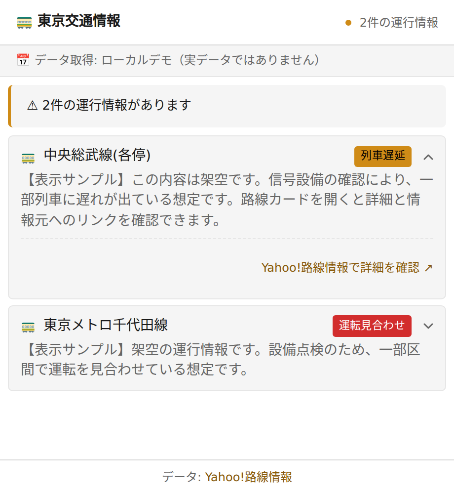
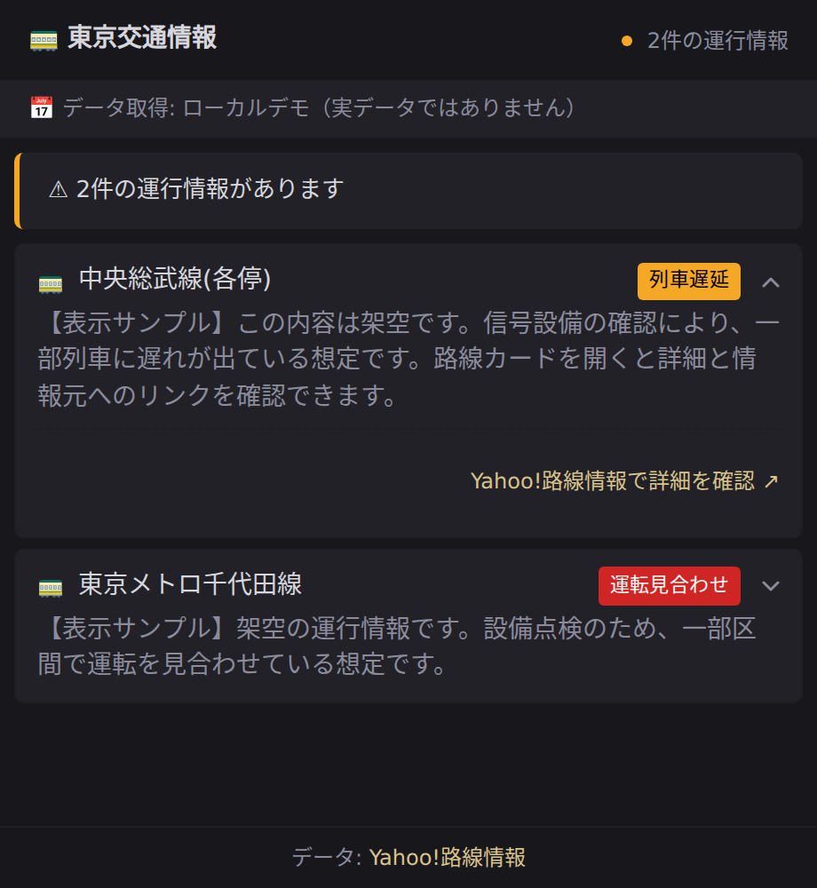

# Tokyo Transit Monitor

**東京圏の遅延・運休情報を、ひと目で。**

Yahoo!路線情報から対象路線の運行情報を定期取得し、ひとつのダッシュボードにまとめます。GitHub Actions と GitHub Pages で動き、Glance などへの埋め込みにも使えます。

Python + uv · GitHub Actions + Pages · ライト／ダーク対応

[](https://github.com/workHMZ/tokyo-transit-monitor/actions/workflows/run-scraper.yml)
[](./LICENSE)

[日本語](#日本語) · [English](#english) · [中文](#中文) · [導入](#導入)

**[ダッシュボードを開く · Open dashboard · 打开看板](https://workhmz.github.io/tokyo-transit-monitor/)**

<table>
  <tr>
    <th width="50%">ライト · Light · 浅色</th>
    <th width="50%">ダーク · Dark · 深色</th>
  </tr>
  <tr>
    <td></td>
    <td></td>
  </tr>
</table>

<sub>日本語 UI・架空のサンプルデータ · Japanese UI, fictional sample data · 日语界面，虚构示例数据</sub>

## 日本語

### 何が見られるか

- JR、東京メトロ、都営地下鉄、私鉄など、[設定済みの 52 路線](./lines.json)を対象に遅延・運休情報を表示。
- 路線を開いて詳細を確認し、Yahoo!路線情報の元ページへ移動。
- 取得時刻、データの古さ、読み込みエラーを表示。画面は日本語で、明暗テーマとスマートフォンに対応。

### 更新のしくみ

| 処理 | タイミング |
|---|---|
| Yahoo! から取得・Pages に公開 | 毎日 **07:15・11:45・17:15 JST** に定期実行。手動実行も可能 |
| ブラウザの表示更新 | **5 分ごと**に公開済み JSON を再取得。タブへ戻ったときも更新 |
| Synology Chat 通知 | Webhook を設定し、手動実行で通知を有効にした場合のみ |

実行時刻は GitHub Actions の混雑状況により遅れる場合があります。画面の再読み込みでは Yahoo! の再取得は行いません。移動前は取得時刻と元ページも確認してください。

### 実装の工夫

<details>
<summary>誤った正常表示の防止、詳細の補完、更新失敗への対応</summary>

| 工夫 | 実装 |
|---|---|
| **解析できない状態を見逃さない** | 必須の HTML 構造や異常情報の行が不完全なら処理を失敗させ、誤った正常結果の公開を防止。JSON は一時ファイルから置き換えて保存。 |
| **状態と詳細をそろえる** | 詳細ページから状態・本文を一緒に取得し、平常運転への復旧が確認できた情報は一覧から除外。補完できない場合は一覧の要約を維持。 |
| **リクエスト量を抑える** | HTTP セッションを再利用し、タイムアウトと有限回の再試行を設定。詳細取得は最大 20 件、1 秒間隔、120 秒の処理予算で管理。 |
| **路線名の不一致を表示** | 設定した名称が取得元に見つからない場合は `unmatched_lines` に記録して画面に表示。路線設定とパーサーは保存済み HTML で回帰テスト。 |
| **更新失敗時も状況を伝える** | 予定時刻と 90 分の猶予からデータの古さを判定。読み込み失敗時は同じページ内の直前の成功データを残し、エラーを表示。 |
| **日常の閲覧を軽くする** | フロントエンドのビルド不要。更新後も詳細の開閉状態とキーボードフォーカスを保持し、uv キャッシュで依存関係の再ダウンロードを削減。 |

詳細取得の予算は次のリクエスト前に確認するため、処理全体が必ず 120 秒以内に終わるわけではありません。未取得の路線名は改名などを調べるための手がかりで、自動修正は行いません。

**コード：** [取得・解析](./app.py) · [ダッシュボード](./index.html) · [実行・公開](./.github/workflows/run-scraper.yml) · [解析テスト](./tests/test_parser.py) · [画面テスト](./tests/dashboard.html)

</details>

### 導入

1. このリポジトリを **Fork** し、**Actions** タブでワークフローを有効にします。
2. **Settings → Pages → Build and deployment → Source** を **GitHub Actions** に設定します。
3. **Actions → Run Scraper → Run workflow** で実行します。通知は既定で有効です。不要な場合は `send_notification: false` を選びます。
4. 完了後、Pages に表示された自分のサイト URL を開きます。

**通知を使う場合：** Repository secret `SYNOLOGY_CHAT_WEBHOOK` に Synology Chat の Incoming Webhook URL を設定し、手動実行で `send_notification: true` を選びます。異常がない場合も通知します。Fork 後は、[ワークフロー](./.github/workflows/run-scraper.yml)内の通知用ダッシュボード URL も自分の URL に変更してください。

定期実行は画面のみを更新します。現在のワークフローは push / PR では起動しません。公開リポジトリで長期間活動がない場合は、Actions の定期実行が無効になっていないか確認してください。

<details>
<summary>ローカル実行・テスト・対象路線の変更</summary>

[uv](https://docs.astral.sh/uv/getting-started/installation/) と、Actions と同じ Python 3.13 を使います。

```bash
git clone https://github.com/workHMZ/tokyo-transit-monitor.git
cd tokyo-transit-monitor
uv run --python 3.13 --with-requirements requirements.txt app.py
uv run --python 3.13 python -m http.server 8000 --bind 127.0.0.1
```

取得結果を `transit_data.json` に保存します。`http://127.0.0.1:8000/` で画面を開けます。JSON は生成物のためコミット不要です。ローカルの `app.py` は通知を送りません。

**解析テスト：**

```bash
uv run --python 3.13 --with-requirements requirements.txt --with pytest \
  python -m pytest tests/ -q
```

**画面テスト：** 上のローカルサーバーで `http://127.0.0.1:8000/tests/dashboard.html` を開きます。サンプルデータを使い、Yahoo! の取得や通知は行いません。この画面テストは手動実行で、Actions では解析テストを実行します。

**路線の変更：** [lines.json](./lines.json) の名称を Yahoo! の表記に合わせて編集します。路線数を変更した場合は [tests/test_parser.py](./tests/test_parser.py) の件数の検証も更新し、必要に応じて [HTML サンプル](./tests/fixtures/)を更新してください。

</details>

**データについて：** 表示は対象路線の取得時点の情報です。「異常なし」は、その回に取得できた対象路線の異常情報がないことを示します。鉄道事業者や Yahoo! の公式サービスではありません。最新情報は [Yahoo!路線情報](https://transit.yahoo.co.jp/diainfo/area/4)または各鉄道事業者で確認してください。

---

## English

**Tokyo-area train disruptions, in one dashboard.**

Collects train service updates for selected lines from Yahoo! Japan Transit and publishes them through GitHub Actions and GitHub Pages. It also works as an embedded panel in Glance and similar dashboards.

### What you can see

- Delays and suspensions for [52 configured lines](./lines.json), including JR, Tokyo Metro, Toei, and private railways.
- Expandable incident details with links to the original Yahoo! pages.
- Collection time, stale-data notices, and loading errors. The dashboard UI is in Japanese, with light/dark themes and a responsive layout.

### How updates work

| Task | Timing |
|---|---|
| Collect from Yahoo! and publish to Pages | Scheduled daily at **07:15, 11:45, and 17:15 JST**, plus manual runs |
| Refresh the browser view | Reloads the published JSON every **5 minutes** and when returning to the tab |
| Notify Synology Chat | Only when a webhook is configured and notifications are enabled for a manual run |

GitHub Actions scheduling can be delayed. Reloading the dashboard does not start a new Yahoo! collection. Check the collection time and source page before travelling.

### Engineering choices

<details>
<summary>Parsing safeguards, incident details, and recovery from refresh failures</summary>

| Improvement | Implementation |
|---|---|
| **Avoid false all-clear results** | Missing required HTML structure or incomplete incident rows fail the run. JSON is written through a temporary file and replaced atomically. |
| **Keep status and details consistent** | Read both from the same detail page; remove incidents once normal service is confirmed. If enrichment fails, keep the listing summary. |
| **Bound upstream requests** | Reuse an HTTP session with timeouts and limited retries. Detail collection uses a 20-page limit, one-second spacing, and a 120-second budget. |
| **Surface missing line names** | Record configured names absent from the source as `unmatched_lines` and show a notice. Saved HTML fixtures cover parser and line-list regressions. |
| **Make refresh failures visible** | Check staleness against scheduled runs with a 90-minute grace period. A failed reload keeps the current page's last successful data and shows an error. |
| **Keep everyday use lightweight** | No frontend build step. Refreshes preserve expanded details and keyboard focus; uv caching reduces repeated dependency downloads. |

The detail-fetch budget is checked before the next request, so it is not a hard 120-second runtime limit. Missing line names prompt investigation; the app does not automatically identify or repair renames.

**Code:** [Collection & parsing](./app.py) · [Dashboard](./index.html) · [Workflow](./.github/workflows/run-scraper.yml) · [Parser tests](./tests/test_parser.py) · [Browser tests](./tests/dashboard.html)

</details>

### Set up your own instance

1. **Fork** this repository and enable workflows in the **Actions** tab.
2. Set **Settings → Pages → Build and deployment → Source** to **GitHub Actions**.
3. Open **Actions → Run Scraper → Run workflow**. Notifications default to enabled; choose `send_notification: false` to run without sending one.
4. After deployment, open your site URL shown in Pages.

**Optional notifications:** Set the repository secret `SYNOLOGY_CHAT_WEBHOOK` to a Synology Chat incoming webhook URL, then select `send_notification: true` for a manual run. All-clear results also send a message. After forking, update the notification's dashboard URLs in the [workflow](./.github/workflows/run-scraper.yml) to your own site.

Scheduled runs update the dashboard without notifications. The current workflow does not run on pushes or PRs. If a public repository stays inactive for a long period, check that scheduled workflows remain enabled.

<details>
<summary>Local use, tests, and changing monitored lines</summary>

Use [uv](https://docs.astral.sh/uv/getting-started/installation/) with Python 3.13, matching Actions.

```bash
git clone https://github.com/workHMZ/tokyo-transit-monitor.git
cd tokyo-transit-monitor
uv run --python 3.13 --with-requirements requirements.txt app.py
uv run --python 3.13 python -m http.server 8000 --bind 127.0.0.1
```

The scraper saves `transit_data.json`. Open `http://127.0.0.1:8000/` to view it. The generated JSON does not need to be committed. Running `app.py` locally does not send notifications.

**Parser tests:**

```bash
uv run --python 3.13 --with-requirements requirements.txt --with pytest \
  python -m pytest tests/ -q
```

**Browser tests:** With the local server running, open `http://127.0.0.1:8000/tests/dashboard.html`. It uses sample data without scraping Yahoo! or sending notifications. This is a manual browser test; Actions runs the parser tests.

**Change lines:** Edit [lines.json](./lines.json) using Yahoo!'s exact names. If the line count changes, update the count assertions in [tests/test_parser.py](./tests/test_parser.py), and refresh the saved [HTML fixtures](./tests/fixtures/) when needed.

</details>

**About the data:** The view reflects selected lines at collection time. “All clear” means no incidents were found for the configured lines in that run. This is an independent project. Check [Yahoo! Japan Transit](https://transit.yahoo.co.jp/diainfo/area/4) or the railway operator for current information.

---

## 中文

**一个看板，查看东京圈列车延误与停运信息。**

从 Yahoo! 路线情报定时采集指定线路的运行状态，通过 GitHub Actions 和 GitHub Pages 发布，也适合嵌入 Glance 等个人看板。

### 能看到什么

- [预设 52 条线路](./lines.json)的延误与停运信息，涵盖 JR、东京 Metro、都营及部分私铁。
- 展开查看事件详情，并跳转 Yahoo! 原始页面。
- 采集时间、数据陈旧提示和加载错误。界面为日语，支持明暗主题与手机布局。

### 数据怎么更新

| 处理 | 频率 |
|---|---|
| 从 Yahoo! 采集并发布到 Pages | 每天按计划在 **07:15、11:45、17:15 JST** 执行，也可手动运行 |
| 网页刷新 | 每 **5 分钟**重新读取已发布 JSON，切回标签页时也会刷新 |
| Synology Chat 通知 | 配置 Webhook，并在手动运行时启用通知后发送 |

GitHub Actions 可能排队延迟。刷新网页不会触发新的 Yahoo! 采集；出行前请同时确认采集时间和源页面。

### 做了哪些优化

<details>
<summary>防止误报正常、补全事件详情、处理刷新失败</summary>

| 优化 | 具体实现 |
|---|---|
| **避免误报正常** | 缺少必要 HTML 结构或事件行不完整时让采集失败，避免发布错误的正常状态。JSON 通过临时文件原子替换写入。 |
| **状态与详情保持一致** | 从同一详情页读取状态和正文，确认恢复正常的事件从列表移除；详情补全失败时保留列表摘要。 |
| **控制请求量** | 复用 HTTP 会话，设置超时和有限重试。详情采集最多 20 条，间隔 1 秒，并设置 120 秒处理预算。 |
| **发现线路名缺失** | 配置名称未出现在源页面时，记录到 `unmatched_lines` 并在看板提示。保存的 HTML 样本用于解析器和线路表的回归测试。 |
| **刷新失败时保留可读信息** | 按计划执行时刻与 90 分钟宽限判断数据是否陈旧。加载失败时保留当前页面上次成功取得的数据，并显示错误。 |
| **保持轻量与操作连贯** | 前端无需构建；刷新后保留详情展开状态和键盘焦点。uv 缓存减少依赖的重复下载。 |

详情预算在下一个请求前检查，整轮执行不保证在 120 秒内结束。线路名缺失用于提示排查，程序不会自动判定或修复改名。

**源码：** [采集与解析](./app.py) · [看板](./index.html) · [工作流](./.github/workflows/run-scraper.yml) · [解析测试](./tests/test_parser.py) · [浏览器测试](./tests/dashboard.html)

</details>

### 自己部署

1. **Fork** 本仓库，在 **Actions** 页启用工作流。
2. 将 **Settings → Pages → Build and deployment → Source** 设置为 **GitHub Actions**。
3. 打开 **Actions → Run Scraper → Run workflow**。手动运行默认启用通知；不需要时选择 `send_notification: false`。
4. 发布完成后，打开 Pages 设置中显示的个人站点地址。

**可选通知：** 将 Synology Chat Incoming Webhook 地址保存为仓库 Secret `SYNOLOGY_CHAT_WEBHOOK`，手动运行时选择 `send_notification: true`。没有异常时也会发送正常状态消息。Fork 后，还需把[工作流](./.github/workflows/run-scraper.yml)通知模板中的看板 URL 改成自己的地址。

定时运行只更新看板，不发送通知。当前工作流不由 push / PR 触发。公开仓库长期没有活动时，请检查定时工作流是否已被停用。

<details>
<summary>本地运行、测试与修改监控线路</summary>

使用 [uv](https://docs.astral.sh/uv/getting-started/installation/) 和 Python 3.13，与 Actions 保持一致。

```bash
git clone https://github.com/workHMZ/tokyo-transit-monitor.git
cd tokyo-transit-monitor
uv run --python 3.13 --with-requirements requirements.txt app.py
uv run --python 3.13 python -m http.server 8000 --bind 127.0.0.1
```

程序生成 `transit_data.json`，可在 `http://127.0.0.1:8000/` 查看。这个 JSON 是生成文件，无需提交。单独运行 `app.py` 不发送通知。

**解析器测试：**

```bash
uv run --python 3.13 --with-requirements requirements.txt --with pytest \
  python -m pytest tests/ -q
```

**浏览器测试：** 保持本地服务器运行，打开 `http://127.0.0.1:8000/tests/dashboard.html`。测试使用示例数据，不采集 Yahoo!，也不发送通知。浏览器测试需手动打开，Actions 当前运行的是解析器测试。

**修改线路：** 编辑 [lines.json](./lines.json)，名称须与 Yahoo! 表记完全一致。增删线路后，同步更新 [tests/test_parser.py](./tests/test_parser.py) 的数量断言，必要时更新保存的 [HTML 样本](./tests/fixtures/)。

</details>

**数据说明：** 看板展示指定线路在采集时的信息。“无异常”表示该次未取得所配置线路的异常记录。本项目为独立项目，最新情况请以 [Yahoo! 路线情报](https://transit.yahoo.co.jp/diainfo/area/4)或铁路公司发布的信息为准。

---

## ライセンス · License · 许可

**MIT** · [LICENSE](./LICENSE)
